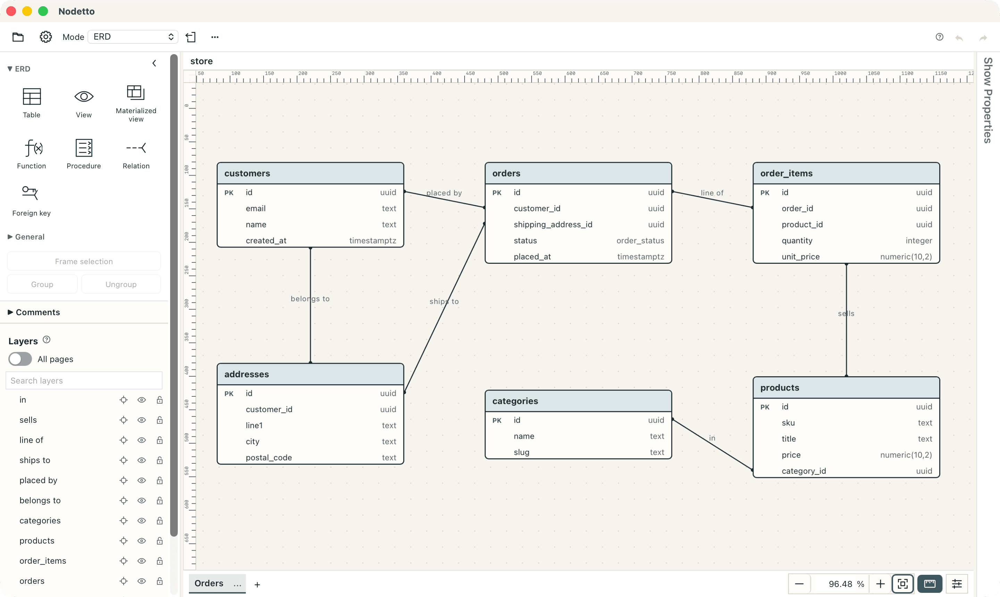
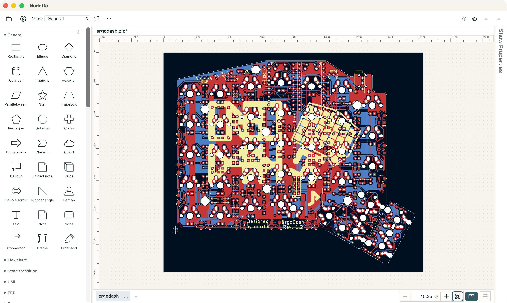

# Nodetto

A desktop diagram editor for ER diagrams, UML, sequence diagrams, flowcharts,
state machines, BPMN, breadboard circuits and app or web design artboards.
Documents are plain, diff-friendly JSONL files, and `nodetto-cli` lets scripts
and AI agents read, draw, check and convert them.



## Install

```bash
brew install --cask tacogips/tap/nodetto
```

Or download the [macOS DMG](https://github.com/tacogips/nodetto-app/releases/latest/download/Nodetto_aarch64.dmg),
or the Linux `.deb`, AppImage or CLI archive from the
[latest release](https://github.com/tacogips/nodetto-app/releases/latest).
See [Installing Nodetto](docs/install.md) for the command-line link and file
associations.

## Features

- **Diagrams**: ER diagrams with PostgreSQL, MySQL and SQLite DDL export, UML
  class and component diagrams, sequence diagrams, state machines, flowcharts
  and BPMN operation flows. See [Editing diagrams](docs/editing.md).
- **Import and export**: Mermaid, draw.io, D2, BPMN XML, SVG, PNG, PDF and
  static websites. See [Import and export](docs/import-export.md).
- **Breadboard circuits**: BOM, netlist, electrical rule checks, KiCad import,
  PCB Gerber export and Gerber import. See
  [Breadboard circuit pages](docs/breadboard/README.md).
- **PCB boards**: open KiCad boards, edit parts and tracks, and export Gerber
  and drill files. See [KiCad PCB boards](docs/pcb/kicad-pcb.md).
- **Design artboards**: web and iPhone screens, transitions, and code export.
  See [Design artboards](docs/design.md).
- **Command line and MCP**: an AI agent edits a document while the desktop app
  shows its changes live. See [Command line](docs/cli.md).



The [ErgoDash](https://github.com/omkbd/ErgoDash) Rev. 1.2 Gerber ZIP opened
from the Open dialog: copper, silkscreen, drill and outline become editable
vector layers. ErgoDash is copyright (c) 2018 omkbd and released under the MIT
License.

## Command line

```bash
nodetto-cli inspect schema.jsonl
nodetto-cli export schema.jsonl --format png --output schema.png
nodetto-cli ddl schema.jsonl --dialect postgresql --check schema.sql
nodetto-cli gerber import board-gerbers.zip --output board.jsonl
```

## Development

```bash
mise install
bun install
mise run dev
```

This repository is the public half of Nodetto: the editor packages and the
Tauri desktop app. The hosted cloud edition lives in a private repository. See
[Development](docs/development.md) for the layout, tasks and release process.

## License

Nodetto is released under the [MIT License](LICENSE). The editor packages,
desktop application and command-line tool use the same license.
